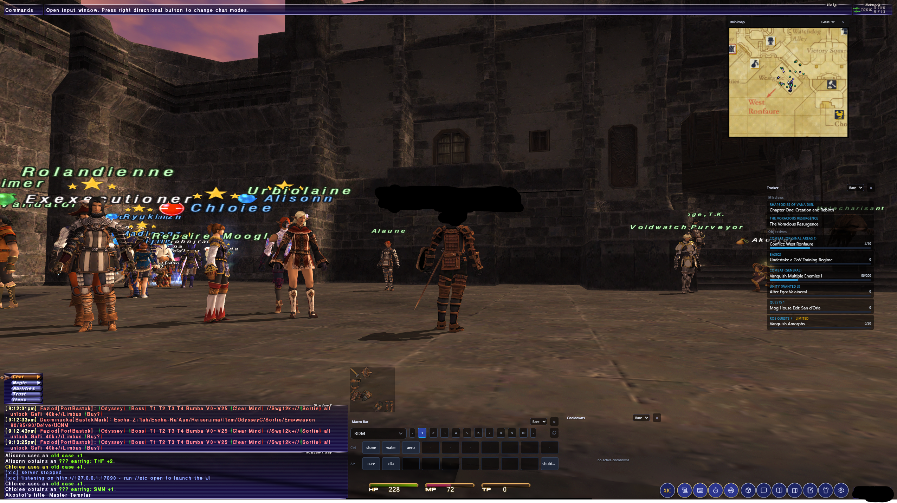
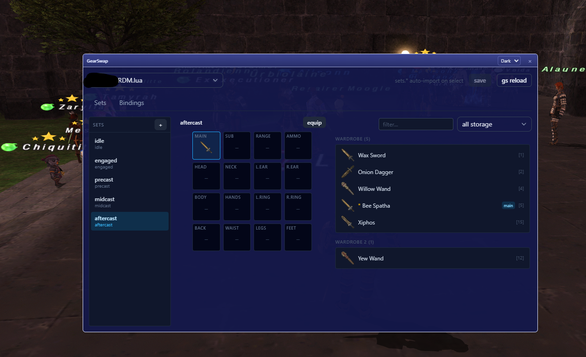
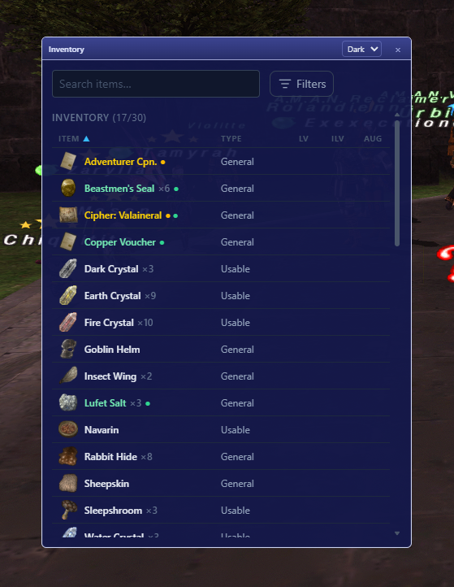
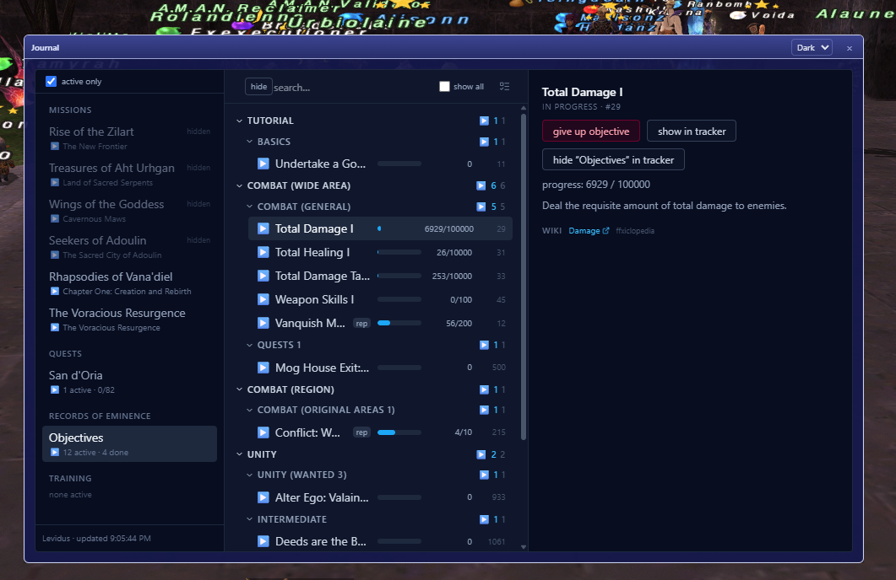
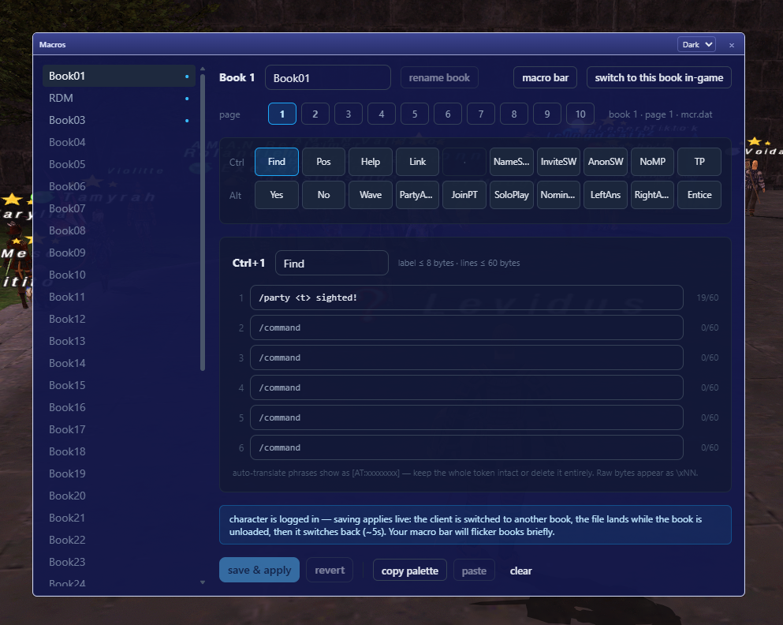

# XI Companion

A persistent companion overlay for Final Fantasy XI — a separate desktop
process that floats always-on-top panels over the game, backed by the
`xicompanion` Windower addon's local HTTP/SSE server. Everything the addon sees
(packets, bags, journal, chat, recasts, map data) streams to the UI;
everything the UI does goes back through injected packets or normal
`input /` commands — no in-game UI hacks, no input blocking.



## Windows

Every view is a page in the main window and can also pop out into its own
detached window. Windows persist their position and size, and each can
pick its own theme (`dark` / `light` / `glass` / `bare`) — `bare` paints
only the controls over the game.

### GearSwap

Set editor with a 16-slot equipment grid, per-file bindings, a
slot/bag-filtered item picker, and tooltips that open outside the main
window. `sets.*` handlers auto-import and changes write back into the
profile's `get_sets()` block.



### Inventory

Every bag with icons, search and bag/slot/type filters, and item actions —
equip/unequip, use, move between bags, drop. Names are color-coded by the
native flag scheme (yellow Rare, green Ex) with the client's dot markers.



### Journal

Missions, quests, Records of Eminence, and Field Manual / Grounds of Valor
training regimes — progress bars, per-entry and per-category tracker
toggles, wiki links, and a "show all" filter. Tracked entries feed the
detached tracker window.



### Macros

A full macro editor on the client's own `mcr` files: books and pages,
Ctrl/Alt 2×10 palette grid, label + 6-line editor with byte counters,
autotranslate phrases, book rename, palette copy/paste, and a live
"save & apply" that switches books in game while it writes.



### Also included

- **Map** — whole-zone radar page with real client map imagery, nearby
  entities, widescan, and click-to-tell/check on players.
- **Minimap** — floating player-centered radar (visible top-right in the
  hero shot).
- **Tracker** — detached journal tracker with live progress bars.
- **Macro bar** — a clickable strip mirroring your in-game palettes.
- **Cooldowns** — ability/spell recast timers.
- **Chat** — unified channels plus `/tell` threads as DMs.
- **Settings** — global + per-window themes and geometry controls.
- **Fab** — the persistent one-row menu bar that spawns/toggles windows.

A [preact-mvc](https://github.com/jwhenry3/preact-mvc) application —
Angular-style modules, DI, and MVC on class-based JSX views rendered by
Preact, with signal reactivity.

## Usage

```text
//lua load xicompanion         # start the addon (spawns the fab menu bar)
//xicompanion open             # open the full UI window
//xicompanion minimap          # toggle the minimap window
//xicompanion tracker          # toggle the tracker window
//xicompanion macrobar         # toggle the macro bar
//xicompanion cooldowns        # toggle the cooldowns window
//xicompanion fab on|off       # toggle the fab
```

## Development

```bash
pmvc serve            # dev server (vite)
pmvc build            # production build
pmvc test             # vitest
pmvc g view my-page   # scaffold a view
pmvc g module admin   # scaffold a feature module

npm run build:addon   # typecheck + build into addon/xicompanion/ui/
npm run build:overlay # go build the Wails shell
npm run deploy        # sync addon -> live Windower install
node scripts/smoke-test.mjs   # addon exercised under fengari
```

See `AGENTS.md` for the architecture notes.
